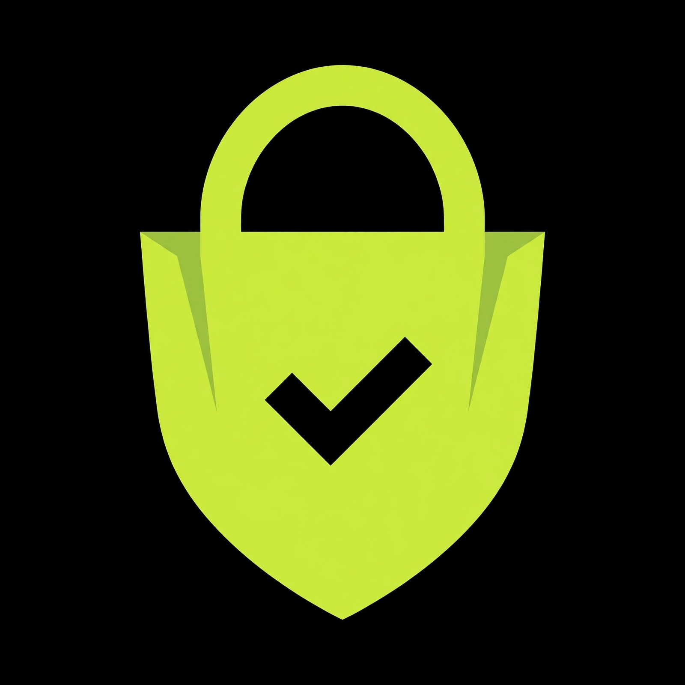

# unictos

**Universal Network of Intelligent Commands, Tools, Operations & Skills.**

The premium, security-first store for AI skills, commands, and tools — Amazon shopping, for AI.

## The idea

Thousands of AI skills, commands, and tools are scattered across GitHub with no quality signal and no safety checks. **unictos** is the store that fixes that: a curated marketplace where every listing is scanned, scored, and pinned to the exact verified version — before it reaches the shelf.

- 🛡️ **Security-first.** Our motto. Every listing carries a public scan report and a Verified Safe badge with teeth: scanned on date, score out of 100, re-scanned on every update, pinned to an immutable version. Never a guarantee — always a process you can inspect.
- 👥 **Community verdict.** Next to the expert scan score ("is it safe"), the community answers "is it good" — Essential / Worth it / Average / Skip — computed from GitHub signals (stars, reviews, issues) plus on-store votes.
- 📱 **Phone-native.** A PWA website (discoverable, SEO-indexed, installable in one tap) plus a native Android app distributed free through third-party stores. No Play Store toll.
- 💰 **Built to earn.** Designed in from day one: donations and affiliates at launch, ads at traction, sponsored listings at scale — clearly labeled, never touching the trust styling.

## Status

**Demo live:** [unictoai.github.io/unictos](https://unictoai.github.io/unictos/) — a working PWA demo of the storefront. Browse, search, filter and sort 24 sample listings; open any skill for its scan report, permissions in plain words, version history and pinned install command; share any skill as a branded image card or a direct link; vote on the community verdict meter.

> Demo data is illustrative sample data, clearly labeled in the demo. The launch catalog will be 100 hand-curated, scanned, human-reviewed listings.

## What's coming

- [ ] **Launch catalog** — 100 hand-curated skills, every one scanned and human-reviewed before it appears.
- [ ] **Verified Safe pipeline** — automated scanning, immutable pinned snapshots, re-scan on every upstream change. Never a silent update.
- [ ] **Share pages** — every skill gets a clean public page (score, badge, one-tap install) that creators can send anywhere. Creators become distribution.
- [ ] **PWA launch** — the live store website. Free to build, free to use.
- [ ] **Native Android app** — one-tap install into on-device agents, background re-scan watching with push notifications, share-sheet intake, offline catalog. PWA first, native as the power companion.
- [ ] **Monetization** — donations and affiliates from day one, ads and sponsored listings only after real traction.

## Brand

- Whole-black UI (`#000000`), lime trust accent (`#CDF14D`) — lime means *checked and safe*, everywhere.
- The mark: a shopping bag fused with a shield, stamped with a check. Store + security + verified, in one glyph. It is never recolored.

---

*unictos — every skill, verified safe.*
